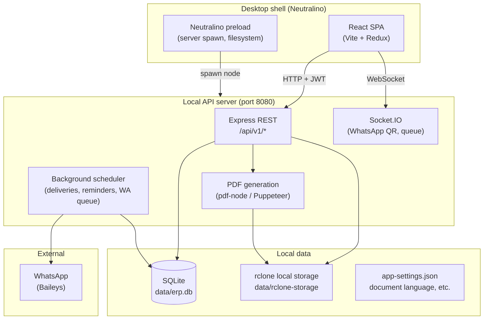

# Gujrat Factory ERP

A desktop ERP application for factory and retail operations: point-of-sale, orders, inventory, suppliers, labour, WhatsApp messaging, invoices/receipts, and local backup. The app runs as a **Neutralino** desktop shell with a **React** frontend and a local **Node.js / Express** API backed by **SQLite**.

---

## Architecture overview



**Runtime flow**

1. The Neutralino desktop app loads the built React UI from `dist/`.
2. On startup, the frontend checks whether the API is up on port **8080**; if not, it spawns the bundled Node server via Neutralino’s `os.spawnProcess`.
3. The UI talks to the API over HTTP (`/api/v1`) and Socket.IO (WhatsApp status/QR).
4. All business data lives locally in SQLite; files (avatars, proofs, WhatsApp attachments) live in rclone-backed local storage under `data/rclone-storage`.

---

## Repository structure

This is an **npm workspaces** monorepo.

```
gujrat-factory-erp/
├── apps/desktop/
│   ├── frontend/          # React 19 + Vite + Tailwind + shadcn/ui
│   ├── server/            # Express API, Drizzle ORM, services, PDF templates
│   ├── backend/           # Neutralino config & desktop shell (neu CLI)
│   └── stage/             # Packaged app / installer assets (Inno Setup)
├── packages/
│   └── server-util/       # Shared API response types & helpers
├── configs/
│   ├── eslint-config/
│   └── ts-config/
└── package.json           # Root workspace + formatting hooks (Husky, Prettier)
```

### `apps/desktop/frontend`

| Area           | Location                                        | Purpose                                                             |
| -------------- | ----------------------------------------------- | ------------------------------------------------------------------- |
| Pages          | `src/pages/`                                    | Home, Dashboard, POS, Orders, Inventory, Customers, Suppliers, etc. |
| API layer      | `src/redux/api/`                                | RTK Query endpoints (`apiSlice` + injected APIs)                    |
| Auth state     | `src/redux/slices/authSlice.ts`                 | JWT user session                                                    |
| Layout         | `src/components/layout/AppLayout.tsx`           | Sidebar navigation                                                  |
| i18n           | `src/i18n/`, `src/context/LanguageProvider.tsx` | English / Urdu UI + document language                               |
| Desktop bridge | `src/lib/server.ts`                             | Health check, spawn embedded Node server                            |
| Routing        | `src/router/index.tsx`                          | React Router (hash mode)                                            |

**Stack:** React 19, TypeScript, Redux Toolkit, React Router, Tailwind CSS 4, Radix/shadcn, Socket.IO client, Vite.

### `apps/desktop/server`

Classic layered Express app:

```
server/
├── index.ts              # Entry: pending restore → rclone → startServer
├── startServer.ts        # HTTP server, Socket.IO, DB migrate, scheduler
├── app.ts                # Express middleware + route mounting
├── routes/               # Thin route definitions
├── controllers/          # Request/response handling
├── services/             # Business logic
├── models/               # Drizzle schema (`tables.ts`, `relations.ts`)
├── migrations/           # SQL migrations (Drizzle)
├── middleware/           # Auth, errors, async wrapper
├── templates/            # EJS templates for PDFs (`order-document.ejs`)
├── utils/                # DB, JWT, WhatsApp, rclone, i18n, backup paths
├── data/                 # Runtime data (gitignored): DB, rclone, settings
├── public/               # Static assets served by API (logo, icons)
└── rclone/               # Bundled rclone binary for local file storage
```

**Stack:** Node.js, Express, Drizzle ORM, SQLite (`better-sqlite3` via drizzle), Baileys (WhatsApp), pdf-node (Puppeteer PDFs), Socket.IO, Winston logging.

### `apps/desktop/backend`

Neutralino desktop wrapper. `prod.neu.config.json` points `documentRoot` at the built frontend `dist/`. The packaged app bundles Node + compiled server under `server/`.

### `packages/server-util`

Shared types (`IConfig`, API envelope shapes) and small utilities used by the server.

---

## Core features

### Sales & orders

- **POS** — immediate orders with cart and checkout.
- **Delayed orders** — orders scheduled for future delivery.
- **Orders** — list, filter, payments, delivery status, returns.
- Order modes: `pos` | `delayed`; statuses include draft → saved; stock deduction on delivery.

### Customers & payments

- Customer ledger (`udhar` / outstanding balance).
- Customer transactions: payments, refunds, proof images.
- Installment-style payments on orders.

### Inventory & products

- Product catalog (category, price, discount, stock).
- Stock history tied to restock receipts.
- Product sales tracking.

### Suppliers & restock

- Supplier directory and supplier–product links.
- Restock orders (draft → ordered → received) with line items.
- Supplier payments and refunds.

### Production

- **Recipes** — BOM: output product + ingredient quantities.
- **Labour** — labourers, per-product rates, production entries (optional recipe consumption), labour transactions.

### Documents & messaging

- **Invoices & receipts** — unified PDF template (`order-document.ejs`):
    - 10 item rows per slip, **3 slips per A4 page**
    - Embedded Windows Arial for English PDFs
    - English / Urdu labels (settings-driven)
- **WhatsApp** (Baileys):
    - QR linking in app
    - Queued text + document sends (invoices, receipts, payment reminders)
    - Daily payment reminders for delivered, underpaid orders

### Administration

- **Users & roles:** `super_admin`, `admin`, `User`
- **Auth:** WhatsApp OTP contact verification, JWT access + refresh cookies
- **Backup & restore** (super admin): full `.bak` zip of DB + rclone storage; restore on next restart
- **Settings:** dark mode, UI language (en/ur), document/message language (en/ur)
- **Community** (super admin): user management

### Analytics

- Dashboard and home sales summaries via analytics endpoints.

---

## Data model (SQLite)

Main tables (see `apps/desktop/server/models/tables.ts`):

| Domain       | Tables                                                                                                                                        |
| ------------ | --------------------------------------------------------------------------------------------------------------------------------------------- |
| Auth         | `users`                                                                                                                                       |
| CRM          | `customers`, `customer_transactions`                                                                                                          |
| Catalog      | `products`, `product_stock_history`, `product_sales`                                                                                          |
| Orders       | `orders`, `order_items`                                                                                                                       |
| Supply chain | `suppliers`, `supplier_products`, `restock_orders`, `restock_order_items`, `supplier_transactions`                                            |
| Production   | `recipes`, `recipe_items`, `labourers`, `labour_rates`, `labour_production_entries`, `labour_production_consumption`, `labourer_transactions` |
| Messaging    | `whatsapp_queue`                                                                                                                              |

Migrations live in `apps/desktop/server/migrations/` and run automatically on server start.

---

## File storage (rclone)

Files are not stored in the database. The server uses a **bundled rclone** instance with a local remote (`erpstorage` → `data/rclone-storage/`):

- User avatars
- Payment proof images
- WhatsApp queue payloads (message text + PDF paths)

Files are served at `GET /api/v1/files/...`. Configuration is auto-generated in `data/rclone.conf` on first run.

---

## API surface

All REST routes are under **`/api/v1`** unless noted.

| Router              | Examples                                         |
| ------------------- | ------------------------------------------------ |
| `user.route`        | login, refresh, profile, avatar, community users |
| `customer.route`    | CRUD, transactions                               |
| `product.route`     | CRUD, stock                                      |
| `order.route`       | CRUD, payments, delivery, `generate-invoices`    |
| `transaction.route` | customer/supplier transaction helpers            |
| `analytics.route`   | sales, dashboard stats                           |
| `supplier.route`    | suppliers, restock                               |
| `restock.route`     | restock order lifecycle                          |
| `recipe.route`      | recipes                                          |
| `labour.route`      | labourers, production, rates                     |
| `whatsapp.route`    | queue status, logout                             |
| `files.route`       | serve stored files                               |
| `settings.route`    | GET/PUT app settings                             |
| `backup.route`      | download / restore `.bak`                        |

**WebSocket events:** `qr`, `whatsapp:status`, `whatsapp:queue:update`, `whatsapp:connected`, `whatsapp:disconnected`.

**Background scheduler** (every 5 minutes by default):

- Process due order deliveries
- Send payment reminder WhatsApp messages
- Drain WhatsApp send queue

---

## Internationalization

| Layer           | Mechanism                                                               |
| --------------- | ----------------------------------------------------------------------- |
| UI              | `LanguageProvider` + `src/i18n/en.ts` / `ur.ts` (localStorage)          |
| PDFs & WhatsApp | `utils/documentI18n.ts` + `data/app-settings.json` (`documentLanguage`) |
| API header      | `X-Document-Language: en \| ur` on PDF-related requests                 |

Urdu PDFs use Noto Sans Arabic; English PDFs embed system Arial from `C:\Windows\Fonts`.

---

## Security & roles

- JWT bearer token (frontend) + HTTP-only refresh cookie
- Route guards: `isAuthenticated`, `authorizeRoles(...)` in middleware
- **super_admin** — backup/restore, community
- **admin** — suppliers, restock, recipes, labour
- **User** — standard operations (POS, orders, customers, etc.)

---

## Development

### Prerequisites

- Node.js 20+
- npm (workspaces)
- Windows (primary target for desktop + Arial PDF embedding)

### Install

```bash
git clone <repo-url>
cd gujrat-factory-erp
npm install
```

### Run API server (development)

```bash
cd apps/desktop/server
cp .env.example .env   # if present; configure PORT, JWT secrets
npm run dev            # tsx watch
# or
npm run build && npm start
```

API defaults to **http://localhost:8080**. Health check: `GET /test`.

### Run frontend (development)

```bash
cd apps/desktop/frontend
# Point VITE_SERVER_URL at the API, e.g. http://localhost:8080
npm run dev
```

### Run full desktop app (Neutralino)

```bash
cd apps/desktop/frontend && npm run build
cd ../server && npm run build
cd ../backend && npm run dev    # neu run + preload watcher
```

### Useful server scripts

| Command               | Description                                                           |
| --------------------- | --------------------------------------------------------------------- |
| `npm run build`       | Compile TypeScript → `dist/`, copy templates/migrations/public/rclone |
| `npm start`           | Run `dist/index.js`                                                   |
| `npm run db:generate` | Generate Drizzle migration from schema changes                        |
| `npm run db:migrate`  | Apply migrations (also runs on startup)                               |

---

## Production build

1. Build frontend → `apps/desktop/frontend/dist`
2. Build server → `apps/desktop/server/dist`
3. Neutralino build → `neu build --config-file prod.neu.config.json`
4. Installer packaging under `apps/desktop/stage/installer/` (Inno Setup)

The packaged app ships with embedded Node, the compiled server, rclone, and the static UI.

---

## Local data paths (runtime)

All under `apps/desktop/server/data/` (created at runtime):

| Path                    | Contents                                   |
| ----------------------- | ------------------------------------------ |
| `erp.db`                | SQLite database                            |
| `rclone-storage/`       | Uploaded files                             |
| `rclone.conf`           | rclone remote config                       |
| `app-settings.json`     | Document language preference               |
| `.restore-pending.json` | Staged backup restore (applied on restart) |

---

## PDF document layout

- Template: `apps/desktop/server/templates/order-document.ejs`
- Logic: `apps/desktop/server/services/document.service.ts`
- **3 slips per A4 sheet** (`SLIPS_PER_PAGE = 3`)
- **10 line items per slip** (`ITEMS_PER_SLIP = 10`)
- Each slip: header (logo, customer, booking info) → items table → totals (subtotal, discount, paid, outstanding, grand total)

---

## Contributing & tooling

- **Prettier** — `npm run format:fix` / `format:check` at repo root
- **Husky** — pre-commit formatting, conventional commit messages
- **ESLint** — per-package configs under `configs/eslint-config`

---

## License

ISC (see root `package.json`). Third-party components include Neutralino, Baileys, rclone, and bundled fonts where applicable.
